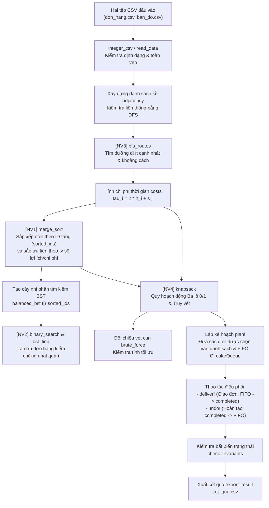

# BÁO CÁO THỰC HÀNH CẤU TRÚC DỮ LIỆU VÀ GIẢI THUẬT

**Đề tài:** Điều phối giao đơn trong khuôn viên trường bằng Julia (GD-1)  
**Ngày thực hành:** 09/10/2026 | **Ngày lập báo cáo:** 15/10/2026  
**Sinh viên thực hiện:** TRẦN HỮU DUY  
**Mã số sinh viên (MSSV):** N24DCDT022  
**Lớp:** D24CQDT01-N  
**Phiên bản Julia:** Julia 1.13.1  
**GitHub Repository:** `https://github.com/diwy06/Thuc_hanh_Julia_2026_10_09`  
**Commit SHA:** `9a91d0d`  

---

## 1. Bài toán và Dữ liệu

### 1.1. Đặc tả bài toán
Một nhân viên giao hàng điều phối các đơn hàng trong khuôn viên trường:
- Mỗi đơn hàng là **một chuyến đi độc lập**: xuất phát từ kho (điểm 1) $\rightarrow$ điểm giao $\rightarrow$ quay trở về kho (điểm 1).
- Bản đồ khuôn viên là đồ thị vô hướng không trọng số gồm 6 đỉnh và 7 cạnh cố định. Mỗi cạnh tiêu tốn 1 đơn vị thời gian di chuyển.
- Thời gian thực hiện đơn hàng $i$ ($\tau_i$) được tính dựa trên đường đi ngắn nhất từ kho 1 tới điểm giao:
  $$\tau_i = 2 \times (\text{số cạnh đường đi ngắn nhất}) + s_i$$
  trong đó $s_i$ là thời gian phục vụ tại điểm giao (nhân 2 vì tính cả lượt đi và về kho).
- **Mục tiêu:** Chọn một tập hợp các đơn hàng trong giới hạn ngân sách thời gian $B$ sao cho tổng lợi ích đạt được là lớn nhất. Đây chính là **bài toán Ba lô 0/1 (0/1 Knapsack Problem)** với chi phí do thuật toán BFS xác định.

### 1.2. Mô hình đồ thị (Bản đồ khuôn viên)
Bản đồ gồm 6 đỉnh (kho là đỉnh 1, các điểm giao từ 2 đến 6) và 7 cạnh cố định:
$$(1,2),\ (1,3),\ (2,4),\ (3,4),\ (3,5),\ (4,6),\ (5,6)$$

**Sơ đồ trực quan đồ thị:**
```
       (1) [Kho xuất phát]
       / \
      /   \
    (2)   (3)
     | \ / |
     |  X  |
     | / \ |
    (4)   (5)
      \   /
       \ /
       (6)
```
*Chi tiết các liên kết:*
- Đỉnh 1 kề với {2, 3}
- Đỉnh 2 kề với {1, 4}
- Đỉnh 3 kề với {1, 4, 5}
- Đỉnh 4 kề với {2, 3, 6}
- Đỉnh 5 kề với {3, 6}
- Đỉnh 6 kề với {4, 5}

### 1.3. Hồ sơ cá nhân hóa theo MSSV: N24DCDT022
Hàm `profile("N24DCDT022")` sinh ra các tham số mô phỏng cá nhân:
- `mssv`: "N24DCDT022"
- `seed`: `7938715074647619`
- Số lượng đơn hàng ($n$): **8 đơn**
- Ngân sách thời gian ($B$): **25**
- Quy tắc hòa khi cùng tỷ số lợi ích/chi phí (`tie`): **0** (ưu tiên ID tăng dần)
- Mã đơn truy vết cá nhân (`trace_id`): **2**

Lệnh tạo dữ liệu:
```bash
julia TH_2026_10_09_Sinh_vien.jl --data N24DCDT022
```

### 1.4. Nội dung hai tệp CSV đầu vào thực tế của N24DCDT022
**Tệp 1: `data/N24DCDT022/don_hang.csv`**
```csv
id,diem_giao,thoi_gian_phuc_vu,loi_ich
1,6,2,6
2,5,1,6
3,6,2,14
4,3,1,12
5,4,1,13
6,5,3,13
7,4,1,9
8,4,2,3
```

**Tệp 2: `data/N24DCDT022/ban_do.csv`**
```csv
u,v
1,2
1,3
2,4
3,4
3,5
4,6
5,6
```

---

## 2. Sơ đồ Xử lý và Mô hình Dữ liệu

### 2.1. Sơ đồ luồng xử lý toàn hệ thống
Toàn bộ chương trình được tổ chức thành một chuỗi xử lý khép kín, trong đó đầu ra của bước trước là dữ liệu đầu vào bắt buộc của bước sau:



### 2.2. Vị trí và vai trò của 4 hàm cài đặt
1. **`[NV1] merge_sort(a, before)`**: Sử dụng chia để trị để sắp xếp danh mục đơn hàng tăng dần theo ID (tạo tiền đề cho tìm kiếm nhị phân và dựng BST cân bằng), đồng thời sắp xếp danh sách đơn ưu tiên theo tỷ số lợi ích/chi phí khi lập thứ tự đưa vào hàng đợi.
2. **`[NV2] binary_search(a, id)`**: Tìm kiếm nhị phân bản ghi đơn hàng trong mảng đã sắp thứ tự theo ID với độ phức tạp $O(\log n)$, dùng để đối chiếu tính nhất quán với cấu trúc BST.
3. **`[NV3] bfs_routes(graph, source=1)`**: Duyệt đồ thị theo chiều rộng để tìm số cạnh ít nhất và đường đi ngắn nhất từ kho 1 tới mọi đỉnh; cung cấp tham số khoảng cách trực tiếp để tính chi phí $\tau_i$ cho bài toán quy hoạch động.
4. **`[NV4] knapsack(orders, costs, budget)`**: Giải bài toán ba lô 0/1 bằng quy hoạch động; lập bảng phương án và truy vết để đưa ra danh sách các đơn hàng tối ưu nhất về mặt lợi ích trong ngân sách thời gian cho phép.

### 2.3. Vai trò các cấu trúc dữ liệu và Bất biến trạng thái
- **`Order`**: Cấu trúc dữ liệu bất biến (immutable struct) lưu trữ thông tin cơ sở của một đơn hàng.
- **`sorted_ids`**: Danh mục mảng lưu các đơn hàng có thứ tự ID tăng dần, phục vụ tìm kiếm nhị phân $O(\log n)$.
- **`costs`** & **`routes`**: Bảng băm (Dict) tra cứu chi phí và tuyến đường theo ID của đơn hàng.
- **`BST` (`balanced_bst`)**: Cây nhị phân tìm kiếm cân bằng lưu trữ đơn hàng theo ID, hỗ trợ tra cứu $O(h)$ khi giao và hoàn tác đơn.
- **`FIFO` (`CircularQueue`)**: Hàng đợi vòng quản lý các đơn hàng đang chờ giao theo đúng nguyên tắc FIFO; hỗ trợ thêm/xóa ở đầu/cuối trong $O(1)$.
- **`Ngăn xếp lịch sử` (`completed`)**: Vector đóng vai trò Stack (LIFO) lưu lịch sử các đơn đã giao để phục vụ hoàn tác chính xác.

**Bất biến trạng thái hệ thống (`check_invariants`):**
Tại mọi thời điểm trước, trong và sau khi giao hàng hoặc hoàn tác, hệ thống luôn đảm bảo:
1. $\text{pending} \cap \text{completed} = \emptyset$ (Một đơn hàng chỉ ở đúng một trạng thái: hoặc đang chờ, hoặc đã giao; không bao giờ vừa chờ vừa giao).
2. $\text{pending} \cup \text{completed} = \text{selected\_ids}$ (Không phát sinh đơn mới và không làm mất đơn trong kế hoạch đã chọn).
3. $\text{length}(\text{Set}(\text{selected\_ids})) == \text{length}(\text{selected\_ids})$ (Tập đơn được chọn không chứa phần tử trùng lặp).
4. $0 \le \text{spent} \le \text{total\_cost}(\text{selected\_ids}) \le B$ (Thời gian đã dùng luôn hợp lệ và không vượt quá ngân sách).
5. $\text{spent} = \sum_{id \in \text{completed}} \text{costs}[id]$ (Thời gian đã tiêu tốn khớp chính xác tổng chi phí các đơn đã giao).
6. $\text{earned} = \sum_{id \in \text{completed}} \text{benefit}[id]$ (Tổng lợi ích nhận được khớp với hàm đệ quy `recursive_benefit`).

---

## 3. Ý tưởng và Truy vết Thuật toán

### 3.1. Ý tưởng và hợp đồng 4 hàm đã hoàn thiện
1. **`merge_sort(a::AbstractVector, before::Function)`**:
   - *Đầu vào/Đầu ra:* Mảng `a`, hàm so sánh `before(x, y)`; trả về một vector mới đã sắp xếp, không làm thay đổi mảng đầu vào.
   - *Ý tưởng:* Sử dụng kỹ thuật chia để trị. Nếu kích thước mảng $\le 1$ thì dừng và trả về bản sao. Ngược lại, chia đôi mảng tại chỉ số giữa, gọi đệ quy sắp xếp hai nửa rồi trộn hai nửa đã có thứ tự.
   - *Đặc điểm:* Để đảm bảo tính sắp xếp ổn định (stable), thuật toán chỉ đưa phần tử của nửa phải vào trước khi nó **thực sự nhỏ hơn** (`before(right[j], left[i]) == true`). Khi hai phần tử bằng nhau, phần tử bên trái luôn được chọn trước.

2. **`binary_search(a::Vector{Order}, id::Int)`**:
   - *Đầu vào/Đầu ra:* Vector `a` đã sắp xếp tăng dần theo ID, số nguyên `id` cần tìm; trả về bản ghi `Order` hoặc `nothing`.
   - *Ý tưởng:* Duy trì đoạn tìm kiếm $[lo, hi]$. Mỗi bước lấy $mid = lo + \lfloor (hi - lo) / 2 \rfloor$. Nếu `a[mid].id == id` thì trả về bản ghi; nếu `a[mid].id < id` thì thu hẹp sang nửa phải $[mid+1, hi]$; ngược lại thu hẹp sang nửa trái $[lo, mid-1]$.
   - *Điều kiện dừng:* Dừng khi tìm thấy hoặc khi $lo > hi$ (trả về `nothing`).

3. **`bfs_routes(graph, source=1)`**:
   - *Đầu vào/Đầu ra:* Danh sách kề `graph`, đỉnh nguồn `source`; trả về `NamedTuple` gồm `(distance, parent, routes)`.
   - *Ý tưởng:* Duyệt theo mức bằng hàng đợi vòng `CircularQueue`. Khởi tạo `distance` bằng $-1$, `parent` bằng $0$. Gán `distance[source] = 0` và đưa `source` vào hàng đợi. Lấy từng đỉnh ra, duyệt các đỉnh kề chưa thăm; gán nhãn khoảng cách và nút cha ngay khi đưa đỉnh kề vào hàng đợi. Sau đó truy ngược mảng `parent` từ từng đỉnh về `source` để dựng lại danh sách đỉnh trên đường đi.
   - *Xử lý biên:* Nếu đỉnh không liên thông với nguồn, `distance` giữ nguyên $-1$ và `routes` là mảng rỗng `Int[]`.

4. **`knapsack(orders, costs, budget)`**:
   - *Đầu vào/Đầu ra:* Danh sách `orders`, từ điển `costs`, số nguyên `budget` $\ge 0$; trả về `(ids, value, cost, table)`.
   - *Ý tưởng:* Xây dựng bảng quy hoạch động kích thước $(n+1) \times (budget+1)$ với công thức chuyển trạng thái:
     - Không chọn đơn $i$: $\text{table}[i+1, b+1] = \text{table}[i, b+1]$
     - Chọn đơn $i$ (nếu $b \ge c_i$): nếu $\text{table}[i, b-c_i+1] + v_i > \text{table}[i+1, b+1]$ thì cập nhật giá trị mới.
     - *Quy tắc hòa:* Sử dụng toán tử so sánh nghiêm ngặt (`>`), khi phương án lấy đơn cho giá trị bằng với không lấy đơn thì **giữ phương án không lấy**.
   - *Truy vết:* Đi ngược từ $i = n$ về $1$ tại $b = budget$, nếu $\text{table}[i+1, b+1] > \text{table}[i, b+1]$ thì đơn $i$ đã được chọn; thêm $o_i.id$ vào danh sách và giảm $b \leftarrow b - c_i$.

---

### 3.2. Truy vết chuyên sâu đơn hàng ID 2 (`trace_id = 2`)
Theo hồ sơ cá nhân của MSSV N24DCDT022, `trace_id = 2`. Dưới đây là hành trình của đơn ID 2 qua từng chặng của hệ thống:

1. **Từ CSV (`don_hang.csv`):**
   - Bản ghi: `2,5,1,6` $\rightarrow$ ID = 2, điểm giao = 5, thời gian phục vụ $s_2 = 1$, lợi ích $v_2 = 6$.
2. **Qua Sắp xếp và Tìm kiếm nhị phân (`binary_search`):**
   - Danh sách sau khi sắp xếp tăng theo ID: `[1, 2, 3, 4, 5, 6, 7, 8]`.
   - Bảng truy vết tìm kiếm nhị phân ID 2:
     | Bước | $lo$ | $hi$ | $mid$ | $a[mid].id$ | So sánh với 2 | Đoạn thu hẹp tiếp theo |
     | :---: | :---: | :---: | :---: | :---: | :---: | :---: |
     | 1 | 1 | 8 | 4 | 4 | $4 > 2 \rightarrow$ tìm bên trái | $[1, 3]$ |
     | 2 | 1 | 3 | 2 | 2 | $2 == 2 \rightarrow$ **Tìm thấy!** | Trả về `Order(2, 5, 1, 6)` |
3. **Qua BFS và tính chi phí thời gian:**
   - Điểm giao của đơn 2 là đỉnh 5.
   - BFS từ đỉnh 1: $1 \rightarrow 3 \rightarrow 5$. Số cạnh $h = 2$.
   - Chi phí thời gian: $\tau_2 = 2 \times 2 + s_2 = 4 + 1 = 5$.
   - Tuyến đường: `[1, 3, 5]`.
4. **Qua Quy hoạch động Ba lô 0/1 (`knapsack`):**
   - Tỷ số lợi ích/chi phí của đơn 2 là $6 / 5 = 1.2$.
   - Trong bài toán DP với ngân sách 25, đơn 2 được chọn vào tập nghiệm tối ưu cùng các đơn {4, 5, 6, 7}.
5. **Qua Điều phối Giao hàng và Hoàn tác:**
   - Kế hoạch đưa đơn 2 vào hàng đợi `pending` tại vị trí cuối cùng trong tập chọn: `[4, 5, 6, 7, 2]`.
   - Lần lượt giao các đơn 4, 5, 6, 7 rồi giao đơn 2.
   - Khi giao đơn 2: lấy từ FIFO, chuyển vào `completed`, chi phí tăng từ 20 lên 25, lợi ích tăng từ 47 lên 53.
6. **Dòng kết quả xuất ra trong `ket_qua.csv`:**
   ```csv
   2,5,2,5,6,1-3-5,1,1,da_giao
   ```

---

### 3.3. Truy vết BFS và Knapsack trên dữ liệu mẫu MINI001

#### A. Truy vết BFS từ kho 1 trên bản đồ 7 cạnh:
- Hàng kề các đỉnh (đã sắp xếp tăng dần):  
  $1: [2, 3];\ 2: [1, 4];\ 3: [1, 4, 5];\ 4: [2, 3, 6];\ 5: [3, 6];\ 6: [4, 5]$

| Bước | Lấy đỉnh $u$ | Trạng thái hàng đợi FIFO | Đỉnh kề $v$ duyệt | Cập nhật $distance$ | Cập nhật $parent$ |
| :---: | :---: | :---: | :---: | :---: | :---: |
| Khởi tạo | - | `[1]` | - | `distance[1] = 0` | `parent[1] = 0` |
| 1 | 1 | `[2, 3]` | 2, 3 | `d[2]=1, d[3]=1` | `p[2]=1, p[3]=1` |
| 2 | 2 | `[3, 4]` | 4 | `d[4]=2` | `p[4]=2` |
| 3 | 3 | `[4, 5]` | 4 (đã thăm), 5 | `d[5]=2` | `p[5]=3` |
| 4 | 4 | `[5, 6]` | 6 | `d[6]=3` | `p[6]=4` |
| 5 | 5 | `[6]` | 6 (đã thăm) | - | - |
| 6 | 6 | `[]` | - | - | - |

**Kết quả BFS:**
- $distance = [0, 1, 1, 2, 2, 3]$
- $parent = [0, 1, 1, 2, 3, 4]$
- Chi phí 3 đơn mẫu:
  - Đơn 1 (giao 2, $s=1$): $\tau_1 = 2 \times 1 + 1 = 3$
  - Đơn 2 (giao 4, $s=1$): $\tau_2 = 2 \times 2 + 1 = 5$
  - Đơn 3 (giao 6, $s=1$): $\tau_3 = 2 \times 3 + 1 = 7$

#### B. Bảng quy hoạch động MINI001 (Ngân sách $B = 8$):
Ba đơn hàng: $o_1(c=3, v=6), o_2(c=5, v=8), o_3(c=7, v=10)$.

**Bảng giá trị $F(i, b)$ — Tương ứng trong Julia là `table[i+1, b+1]`:**

| Hàng / Cột | $b=0$ | $b=1$ | $b=2$ | $b=3$ | $b=4$ | $b=5$ | $b=6$ | $b=7$ | $b=8$ |
| :--- | :---: | :---: | :---: | :---: | :---: | :---: | :---: | :---: | :---: |
| **$i=0$ (chưa xét đơn)** | 0 | 0 | 0 | 0 | 0 | 0 | 0 | 0 | 0 |
| **$i=1$ ($c_1=3, v_1=6$)** | 0 | 0 | 0 | 6 | 6 | 6 | 6 | 6 | 6 |
| **$i=2$ ($c_2=5, v_2=8$)** | 0 | 0 | 0 | 6 | 6 | 8 | 8 | 8 | **14** |
| **$i=3$ ($c_3=7, v_3=10$)** | 0 | 0 | 0 | 6 | 6 | 8 | 8 | 10 | **14** |

#### C. Giải thích chi tiết ô $F(2,8)$ (`table[3,9]` trong Julia):
- Khi xét $i=2$ (đơn 2 với chi phí $c_2 = 5$, lợi ích $v_2 = 8$) và ngân sách $b = 8$:
- **Nhánh 1 (Không chọn đơn 2):** Lấy kết quả tối ưu từ $i-1=1$ đơn đầu với ngân sách 8:
  $$F(1, 8) = \text{table}[2, 9] = 6$$
- **Nhánh 2 (Chọn đơn 2):** Cần dùng chi phí $c_2 = 5$, ngân sách còn lại là $8 - 5 = 3$. Lấy lợi ích của đơn 2 cộng với giá trị tối ưu của $i-1=1$ đơn đầu tại ngân sách 3:
  $$F(1, 3) + v_2 = \text{table}[2, 4] + 8 = 6 + 8 = 14$$
- So sánh hai nhánh: $\max(6, 14) = 14 \rightarrow$ Chọn lấy đơn 2, ghi nhận giá trị 14 vào ô `table[3,9]`.
- **Vì sao nhánh chọn phải lấy từ hàng trước ($i-1$)?**  
  Vì trong bài toán ba lô 0/1, mỗi đơn hàng chỉ được phép giao tối đa một lần. Nếu lấy từ hàng $i$ ($F(i, b-c_i) + v_i$), đơn hàng $i$ có thể bị chọn nhiều lần liên tiếp (quy hoạch động cho bài toán ba lô không giới hạn).

#### D. Truy vết tập đơn chọn:
- Tại $i=3, b=8$: `table[4,9] == table[3,9] == 14` $\rightarrow$ Không chọn đơn 3.
- Tại $i=2, b=8$: `table[3,9] == 14 > table[2,9] == 6` $\rightarrow$ **Chọn đơn 2**; ngân sách còn lại $b = 8 - 5 = 3$.
- Tại $i=1, b=3$: `table[2,4] == 6 > table[1,4] == 0` $\rightarrow$ **Chọn đơn 1**; ngân sách còn lại $b = 3 - 3 = 0$.
- **Kết quả:** Tập đơn chọn là **{1, 2}**, tổng chi phí $= 3 + 5 = 8$, tổng lợi ích $= 6 + 8 = 14$.

---

## 4. Kiểm thử và Kết quả Thực tế

### 4.1. Bảng kết quả chạy các pha kiểm thử
Kiểm thử được thực hiện bằng bộ kiểm tra độc lập `TH_2026_10_09_Kiem_thu.jl`:

| Pha kiểm thử | Lệnh thực thi | Kết quả mong đợi | Kết quả thực tế | Trạng thái |
| :--- | :--- | :--- | :--- | :---: |
| **data** | `julia TH_2026_10_09_Kiem_thu.jl --phase=data` | Đạt 12/12 kiểm tra dữ liệu | `DAT pha data: 12 phép kiểm tra.` | **ĐẠT** |
| **sort** | `julia TH_2026_10_09_Kiem_thu.jl --phase=sort` | Đạt 8/8 kiểm tra sắp xếp | `DAT pha sort: 8 phép kiểm tra.` | **ĐẠT** |
| **search** | `julia TH_2026_10_09_Kiem_thu.jl --phase=search` | Đạt 5/5 kiểm tra tìm kiếm | `DAT pha search: 5 phép kiểm tra.` | **ĐẠT** |
| **bfs** | `julia TH_2026_10_09_Kiem_thu.jl --phase=bfs` | Đạt 7/7 kiểm tra BFS | `DAT pha bfs: 7 phép kiểm tra.` | **ĐẠT** |
| **dp** | `julia TH_2026_10_09_Kiem_thu.jl --phase=dp` | Đạt 12/12 kiểm tra quy hoạch động | `DAT pha dp: 12 phép kiểm tra.` | **ĐẠT** |
| **app** | `julia TH_2026_10_09_Kiem_thu.jl --phase=app` | Đạt 16/16 kiểm tra liên kết trọn luồng | `DAT pha app: 16 phép kiểm tra.` | **ĐẠT** |
| **all** | `julia TH_2026_10_09_Kiem_thu.jl --phase=all` | Đạt toàn bộ 60 kiểm tra | `DAT: 60 phép kiểm tra; bài sinh viên.` | **ĐẠT (60/60)** |

**Ảnh chụp output thật từ terminal:**
```text
DAT pha data: 12 phép kiểm tra.
DAT pha sort: 8 phép kiểm tra.
DAT pha search: 5 phép kiểm tra.
DAT pha bfs: 7 phép kiểm tra.
DAT pha dp: 12 phép kiểm tra.
DAT pha app: 16 phép kiểm tra.
DAT: 60 phép kiểm tra; bài sinh viên.
```

---

### 4.2. Chuỗi thao tác Điều phối: Giao – Hoàn tác – Giao hết

#### A. Trên bộ dữ liệu mẫu MINI001:
```text
MINI001 | Ngân sách 8 | DP 14 | Vét cạn 14

MSSV: MINI001 | Ngân sách: 8
ID | Điểm giao | Phục vụ | Chi phí BFS | Lợi ích | Tuyến đi
1 | 2 | 1 | 3 | 6 | 1 -> 2
2 | 4 | 1 | 5 | 8 | 1 -> 2 -> 4
3 | 6 | 1 | 7 | 10 | 1 -> 2 -> 4 -> 6
Đã chọn: [1, 2] | Đang chờ: [1, 2]
Đã giao: Int64[] | Đã dùng: 0 | Lợi ích đã nhận: 0

Giao đơn 1 | Tuyến 1 -> 2 -> về kho 1 | Thời gian 3 | Lợi ích 6
Đang chờ [2] | Đã giao [1] | Đã dùng 3 | Đã nhận 6

Hoàn tác đơn 1 | Tuyến 1 -> 2 -> về kho 1 | Thời gian 3 | Lợi ích 6
Đang chờ [1, 2] | Đã giao Int64[] | Đã dùng 0 | Đã nhận 0

Giao đơn 1 | Tuyến 1 -> 2 -> về kho 1 | Thời gian 3 | Lợi ích 6
Đang chờ [2] | Đã giao [1] | Đã dùng 3 | Đã nhận 6

Giao đơn 2 | Tuyến 1 -> 2 -> 4 -> về kho 1 | Thời gian 5 | Lợi ích 8
Đang chờ Int64[] | Đã giao [1, 2] | Đã dùng 8 | Đã nhận 14

Đã xuất: data/MINI001/ket_qua.csv
```

#### B. Trên bộ dữ liệu cá nhân N24DCDT022 ($B = 25$):
- **Tập đơn được chọn:** {4, 5, 6, 7, 2}
- **Chi phí tương ứng:** $3 + 5 + 7 + 5 + 5 = 25$ (sử dụng 100% ngân sách)
- **Tổng lợi ích đạt được:** $12 + 13 + 13 + 9 + 6 = 53$
- **Kết quả đối chiếu:** DP = 53; Vét cạn (Brute Force) = 53; Tham lam (Greedy) = 53.

**Bảng theo dõi trạng thái qua chuỗi thao tác:**

| Bước thao tác | Hàng đợi chờ (`pending`) | Ngăn xếp đã giao (`completed`) | Đã dùng (`spent`) | Đã nhận (`earned`) |
| :--- | :---: | :---: | :---: | :---: |
| Sau khi lập kế hoạch | `[4, 5, 6, 7, 2]` | `[]` | 0 | 0 |
| Giao đơn 4 | `[5, 6, 7, 2]` | `[4]` | 3 | 12 |
| Hoàn tác đơn 4 | `[4, 5, 6, 7, 2]` | `[]` | 0 | 0 |
| Giao lại đơn 4 | `[5, 6, 7, 2]` | `[4]` | 3 | 12 |
| Giao đơn 5 | `[6, 7, 2]` | `[4, 5]` | 8 | 25 |
| Giao đơn 6 | `[7, 2]` | `[4, 5, 6]` | 15 | 38 |
| Giao đơn 7 | `[2]` | `[4, 5, 6, 7]` | 20 | 47 |
| Giao đơn 2 | `[]` | `[4, 5, 6, 7, 2]` | 25 | 53 |

**Nội dung đầy đủ của tệp xuất `data/N24DCDT022/ket_qua.csv`:**
```csv
id,diem_giao,so_canh,chi_phi,loi_ich,tuyen_di,duoc_chon,da_giao,trang_thai
1,6,3,8,6,1-2-4-6,0,0,khong_chon
2,5,2,5,6,1-3-5,1,1,da_giao
3,6,3,8,14,1-2-4-6,0,0,khong_chon
4,3,1,3,12,1-3,1,1,da_giao
5,4,2,5,13,1-2-4,1,1,da_giao
6,5,2,7,13,1-3-5,1,1,da_giao
7,4,2,5,9,1-2-4,1,1,da_giao
8,4,2,6,3,1-2-4,0,0,khong_chon
```

---

### 4.3. Các lỗi đã gặp và cách khắc phục trong quá trình cài đặt
1. **Lỗi sắp xếp không ổn định trong `merge_sort`:**
   - *Nguyên nhân:* Khi trộn hai nửa, nếu dùng điều kiện `before(left[i], right[j])` hoặc so sánh không cẩn thận khi hai phần tử có khóa bằng nhau, thứ tự ban đầu của các phần tử hòa bị đảo lộn.
   - *Cách sửa:* Luôn ưu tiên chọn phần tử bên trái khi hai bên hòa; chỉ lấy phần tử bên phải khi nó thực sự đứng trước: `if before(right[j], left[i]) ... else (lấy left[i])`.
2. **Lỗi chỉ số mảng 1-based trong Julia cho bài toán Ba lô:**
   - *Nguyên nhân:* Trạng thái cơ sở có $i = 0$ và ngân sách $b = 0$. Trong các ngôn ngữ khác, mảng bắt đầu từ 0 (`table[0][0]`), nhưng Julia đánh chỉ số từ 1. Việc truy cập trực tiếp `table[i, b]` gây lỗi `BoundsError` tại $b = 0$.
   - *Cách sửa:* Khởi tạo bảng kích thước $(n+1) \times (B+1)$ và ánh xạ trạng thái $F(i, b)$ sang chỉ số `table[i+1, b+1]`.
3. **Lỗi quy tắc hòa trong bài toán Ba lô:**
   - *Nguyên nhân:* Khi phương án chọn đơn $i$ cho giá trị bằng với không chọn, việc dùng `>=` đã ghi đè phương án, dẫn đến truy vết sai tập đơn so với yêu cầu của đề bài.
   - *Cách sửa:* Dùng phép so sánh nghiêm ngặt `>`: `if b >= ci && table[i, b-ci+1] + o.benefit > table[i+1, b+1]`.
4. **Lỗi lặp đỉnh trong BFS:**
   - *Nguyên nhân:* Nếu chỉ đánh dấu `distance` khi lấy đỉnh ra khỏi hàng đợi (`dequeue!`), một đỉnh có thể bị thêm vào hàng đợi nhiều lần bởi các đỉnh kề trước đó.
   - *Cách sửa:* Đánh dấu `distance[v] = distance[u] + 1` và gán `parent[v] = u` ngay lập tức trước khi gọi `enqueue!(q, v)`.

---

## 5. Phân tích Thuật toán và Giới hạn

### 5.1. Độ phức tạp thời gian và không gian
| Thuật toán / Hàm | Độ phức tạp thời gian | Bộ nhớ phụ (Không gian) | Giải thích chi tiết |
| :--- | :---: | :---: | :--- |
| **`merge_sort`** | $O(n \log n)$ | $O(n)$ | Cây đệ quy có chiều cao $\log_2 n$, mỗi tầng thực hiện trộn $n$ phần tử. Cần cấp phát mảng tạm chứa kết quả. |
| **`binary_search`** | $O(\log n)$ | $O(1)$ | Không gian tìm kiếm giảm một nửa sau mỗi bước so sánh. Chỉ dùng các biến chỉ số con trỏ `lo, hi, mid`. |
| **`bfs_routes`** | $O(V + E)$ | $O(V)$ | Mỗi đỉnh vào và ra khỏi FIFO tối đa một lần; mỗi cạnh được duyệt hai chiều. Mảng khoảng cách, cha và tuyến đường tốn $O(V)$. |
| **`knapsack`** | $O(n \cdot B)$ | $O(n \cdot B)$ | Lập bảng kích thước $(n+1) \times (B+1)$ với hai vòng lặp lồng nhau. Bước truy vết tốn $O(n)$. |

### 5.2. Điều kiện áp dụng BFS tìm đường ngắn nhất
Thuật toán BFS chỉ tìm được đường đi ngắn nhất khi đồ thị **không có trọng số** hoặc **tất cả các cạnh đều có cùng trọng số không âm** (trong bài này mỗi cạnh tốn đúng 1 đơn vị thời gian).  
Nếu các cạnh có độ dài hoặc thời gian di chuyển khác nhau, BFS không còn đảm bảo tính tối ưu mà phải sử dụng thuật toán **Dijkstra** (cho trọng số không âm) hoặc **Bellman-Ford** (cho trọng số có thể âm).

### 5.3. Giới hạn của thuật toán Tham lam (Greedy)
Thuật toán tham lam sắp xếp các đơn hàng theo tỷ số giảm dần của $\frac{\text{Lợi ích}}{\text{Chi phí}}$ thường cho kết quả trực quan tốt, nhưng **không luôn đảm bảo nghiệm tối ưu** cho bài toán Ba lô 0/1 do đặc tính rời rạc (không thể chia nhỏ đơn hàng).

**Phản ví dụ cụ thể (được kiểm chứng trong test suite):**
- Ngân sách $B = 10$.
- Ba đơn hàng:
  - Đơn 1: Chi phí = 4, Lợi ích = 9 (Tỷ số = $2.25$)
  - Đơn 2: Chi phí = 5, Lợi ích = 10 (Tỷ số = $2.00$)
  - Đơn 3: Chi phí = 5, Lợi ích = 10 (Tỷ số = $2.00$)
- **Tham lam:** Chọn đơn 1 (chi phí 4, ngân sách còn 6), sau đó chọn đơn 2 (chi phí 5, ngân sách còn 1). Không thể chọn tiếp đơn 3.  
  $\rightarrow$ Tổng lợi ích = $9 + 10 = \mathbf{19}$, chi phí = $9$.
- **Quy hoạch động (Tối ưu):** Chọn đơn 2 và đơn 3 (tổng chi phí $5 + 5 = 10 \le 10$).  
  $\rightarrow$ Tổng lợi ích = $10 + 10 = \mathbf{20}$.  
$\Rightarrow$ Tham lam bị bỏ lại với giá trị kém hơn nghiệm tối ưu.

### 5.4. Chi phí tra cứu BST theo chiều cao $h$
- Tra cứu một khóa trong cây nhị phân tìm kiếm có độ phức tạp phụ thuộc vào chiều cao $h$ của cây: $O(h)$.
- Trong trường hợp tốt nhất (cây cân bằng hoàn hảo), $h = \lfloor \log_2 n \rfloor \rightarrow$ tra cứu đạt $O(\log n)$.
- Trong trường hợp xấu nhất (dữ liệu được chèn theo thứ tự đã sắp xếp tăng hoặc giảm dần mà không có cơ chế tự cân bằng như AVL/Red-Black), cây bị suy biến thành một **danh sách liên kết** với chiều cao $h = n$. Lúc này chi phí tra cứu tăng vọt lên $O(n)$, làm mất hoàn toàn ưu thế của cây tìm kiếm.

### 5.5. Lý do chỉ dùng Vét cạn (Brute Force) cho $n \le 20$
Thuật toán vét cạn xét tất cả các tập con có thể có của $n$ đơn hàng. Không gian tìm kiếm có kích thước $2^n$:
- Với $n = 3$ (MINI001): $2^3 = 8$ trạng thái (chạy tức thì).
- Với $n = 8$ (N24DCDT022): $2^8 = 256$ trạng thái.
- Với $n = 20$: $2^{20} = 1,048,576$ trạng thái (vẫn có thể tính toán trong vài phần trăm giây).
- Với $n = 50$: $2^{50} \approx 1.12 \times 10^{15}$ phép tính. Nếu một máy tính thực hiện $10^9$ phép tính/giây thì cần hơn 13 ngày chạy liên tục; với $n = 100$, thời gian chạy vượt quá tuổi của vũ trụ. Vì vậy vét cạn chỉ có thể đóng vai trò "Oracle" để kiểm chứng tính đúng đắn cho các bài toán quy mô rất nhỏ.

---

## 6. Kết luận và Hướng dẫn Tái lập

### 6.1. Đánh giá hoàn thành
- Đã hoàn thiện đầy đủ và chính xác **4/4 hàm thuật toán cốt lõi** trong `TH_2026_10_09_Sinh_vien.jl`:
  1. `merge_sort`: Sắp xếp trộn ổn định, không dùng hàm sort có sẵn.
  2. `binary_search`: Tìm kiếm nhị phân trên mảng `Order`, trả về bản ghi hoặc `nothing`.
  3. `bfs_routes`: Tìm đường ngắn nhất bằng hàng đợi vòng, hỗ trợ đỉnh không liên thông.
  4. `knapsack`: Quy hoạch động ba lô 0/1, tuân thủ đúng quy tắc hòa và truy vết chính xác.
- Đạt tuyệt đối **60/60 phép kiểm tra** trên toàn bộ 6 pha của test suite `TH_2026_10_09_Kiem_thu.jl`.
- Toàn bộ luồng ứng dụng từ CSV $\rightarrow$ BFS $\rightarrow$ DP $\rightarrow$ Giao/Hoàn tác $\rightarrow$ Xuất CSV chạy mượt mà, đảm bảo tất cả các bất biến cấu trúc dữ liệu.

### 6.2. Các bước tái lập kết quả (Reproducibility)
Để tái lập toàn bộ kết quả từ đầu trên một máy tính mới có cài đặt Julia (phiên bản 1.10 trở lên):

**Bước 1: Tải mã nguồn**
```bash
git clone https://github.com/TranHuuDuy-PTIT/Thuc_hanh_Julia_2026_10_09.git
cd Thuc_hanh_Julia_2026_10_09
```

**Bước 2: Chạy kiểm tra toàn bộ test suite**
```bash
julia TH_2026_10_09_Kiem_thu.jl --phase=all
```
*Kết quả in ra:* `DAT: 60 phép kiểm tra; bài sinh viên.`

**Bước 3: Chạy ứng dụng mẫu (MINI001)**
```bash
julia TH_2026_10_09_Sinh_vien.jl --mini
```

**Bước 4: Sinh dữ liệu và chạy ứng dụng theo MSSV cá nhân**
```bash
# Tạo dữ liệu cho N24DCDT022
julia TH_2026_10_09_Sinh_vien.jl --data N24DCDT022

# Chạy demo tự động cho N24DCDT022
julia TH_2026_10_09_Sinh_vien.jl N24DCDT022
```

**Bước 5: Chạy chế độ Menu tương tác (tùy chọn)**
```bash
julia TH_2026_10_09_Sinh_vien.jl N24DCDT022 --menu
```

**Bước 6: Xem và trình bày báo cáo bằng Pluto Notebook**
Nếu máy đã cài đặt gói `Pluto`:
```julia
julia -e "using Pluto; Pluto.run(notebook=\"TH_2026_10_09_Pluto.jl\")"
```
Nếu máy chưa cài Pluto, có thể chạy trực tiếp bằng lệnh Julia để nạp dữ liệu và xuất báo cáo:
```bash
julia TH_2026_10_09_Pluto.jl
```

---

## PHỤ LỤC: GỢI Ý ĐÁP ÁN 5 CÂU HỎI CUỐI BUỔI (Q1 – Q5)

*Dành cho sinh viên tham khảo và điền vào Phiếu thực hành cá nhân:*

### Q1. Vì sao không được dùng dãy đã sắp giảm theo lợi ích/$\tau$ để tìm kiếm nhị phân theo ID? Nêu tiền điều kiện của hàm tìm kiếm.
- **Trả lời:**
  - Thuật toán tìm kiếm nhị phân theo một khóa (ở đây là `ID`) bắt buộc mảng đầu vào phải **được sắp xếp có thứ tự theo chính khóa tìm kiếm đó** (ở đây là `ID` tăng dần).
  - Một dãy được sắp xếp giảm theo tỷ số $\frac{\text{Lợi ích}}{\tau}$ thì trường `ID` hoàn toàn không có tính chất đơn điệu (các ID xuất hiện lộn xộn). Khi so sánh `ID` cần tìm với phần tử ở giữa $mid$, ta không thể xác định được phần tử cần tìm nằm ở nửa bên trái hay nửa bên phải để loại bỏ một nửa không gian tìm kiếm, dẫn đến tìm kiếm sai hoặc bỏ sót phần tử.
  - **Tiền điều kiện:** Mảng `a` phải chứa các phần tử có trường `id` tăng dần nghiêm ngặt: $a[1].id < a[2].id < \dots < a[n].id$.

### Q2. Với đơn ID 2 tới điểm 4, phục vụ 1 và bản đồ mẫu, giải thích từng thành phần của thời gian thực hiện $\tau$. BFS có tiếp tục cho thời gian ngắn nhất nếu các cạnh mang thời gian khác nhau không?
- **Trả lời:**
  - Công thức thời gian: $\tau_2 = 2 \times h + s_2$.
  - Đường đi ngắn nhất từ kho 1 tới điểm 4 trên bản đồ mẫu là $1 \rightarrow 2 \rightarrow 4$ (hoặc $1 \rightarrow 3 \rightarrow 4$), số cạnh ít nhất là $h = 2$.
  - Nhân 2 vì mỗi chuyến giao hàng là độc lập: nhân viên phải đi từ kho 1 tới điểm 4 (2 đơn vị thời gian) rồi quay trở lại kho 1 (2 đơn vị thời gian), tổng cộng thời gian di chuyển là $2 \times 2 = 4$.
  - Thời gian phục vụ tại điểm giao là $s_2 = 1$.
  - Do đó tổng thời gian là: $\tau_2 = 4 + 1 = 5$.
  - **BFS có tiếp tục cho thời gian ngắn nhất không?** $\rightarrow$ **Không.** BFS chỉ tìm được đường đi ngắn nhất khi mọi cạnh có cùng trọng số. Nếu các cạnh có thời gian di chuyển khác nhau, đường đi có ít cạnh hơn có thể lại tốn nhiều thời gian hơn một đường đi có nhiều cạnh nhưng thời gian trên mỗi cạnh rất nhỏ. Khi đó bắt buộc phải sử dụng thuật toán **Dijkstra**.

### Q3. Giải thích hai phương án tạo ô $F(2,8)$ và vị trí của ô đó trong table Julia. Vì sao nhánh lấy đơn phải dùng hàng trước?
- **Trả lời:**
  - Ô $F(2,8)$ biểu diễn bài toán: tìm tổng lợi ích lớn nhất khi xét 2 đơn đầu tiên với ngân sách thời gian bằng 8.
  - Trong Julia, do mảng có chỉ số 1-based và có trạng thái cơ sở tại hàng 0 và cột 0 nên ô $F(2,8)$ nằm tại tọa độ `table[2+1, 8+1]` = **`table[3, 9]`**.
  - **Hai phương án tạo nên ô này:**
    1. *Phương án 1 (Không lấy đơn 2):* Giữ nguyên giá trị tối ưu của 1 đơn đầu tại cùng ngân sách 8: $\text{table}[2, 9] = 6$.
    2. *Phương án 2 (Lấy đơn 2):* Đơn 2 có chi phí $c_2 = 5$, lợi ích $v_2 = 8$. Ngân sách còn lại là $8 - 5 = 3$. Lấy lợi ích của đơn 2 cộng với giá trị tối ưu của 1 đơn đầu tại ngân sách 3: $\text{table}[2, 4] + 8 = 6 + 8 = 14$.
    3. Ta lấy $\max(6, 14) = 14$.
  - **Lý do nhánh lấy đơn phải dùng hàng trước ($i-1$):** Vì đây là bài toán ba lô 0/1, mỗi đơn chỉ được chọn tối đa một lần. Việc tra cứu ở hàng $i-1$ đảm bảo phần ngân sách còn lại $b - c_i$ chỉ được dùng để chọn trong các đơn từ 1 đến $i-1$, không bị chọn trùng lặp lại đơn $i$.

### Q4. Sau khi giao ID 1 rồi hoàn tác ngay, FIFO, ngăn xếp, tổng thời gian và tổng lợi ích phải thay đổi thế nào? Nêu một bất biến kiểm tra việc không mất hoặc lặp đơn.
- **Trả lời:**
  - *Khi giao ID 1:*
    - ID 1 được lấy ra khỏi đầu hàng đợi FIFO (`dequeue!`).
    - ID 1 được đẩy vào đỉnh ngăn xếp lịch sử `completed` (`push!`).
    - Tổng thời gian tăng thêm $\tau_1 = 3$ (`spent` = 3).
    - Tổng lợi ích tăng thêm $v_1 = 6$ (`earned` = 6).
  - *Khi hoàn tác (undo) ngay lập tức:*
    - ID 1 được lấy ra khỏi đỉnh ngăn xếp lịch sử (`pop!`).
    - ID 1 được đưa trở lại **vào đầu** hàng đợi FIFO (`enqueue_front!`), đảm bảo không làm thay đổi thứ tự ưu tiên của hàng đợi.
    - Tổng thời gian giảm đi 3 (`spent` trở về 0).
    - Tổng lợi ích giảm đi 6 (`earned` trở về 0).
    - Trạng thái hệ thống được khôi phục 100% nguyên vẹn như trước khi giao.
  - **Bất biến kiểm tra không mất hoặc lặp đơn:**
    $$\text{Set}(\text{queue\_values(pending)}) \cup \text{Set(completed)} = \text{Set(selected\_ids)}$$
    đồng thời:
    $$\text{length}(\text{queue\_values(pending)}) + \text{length(completed)} = \text{length(selected\_ids)}$$
    (Tập hợp các đơn đang chờ và đã giao luôn có giao rỗng, và hợp của chúng đúng bằng tập các đơn đã được chọn ban đầu).

### Q5. Cho biết độ phức tạp theo $n, V, E, B$ của sắp xếp trộn, tìm kiếm nhị phân, BFS cốt lõi và DP bảng đầy đủ. Vì sao không thể khẳng định mọi BST đều tra cứu trong $O(\log n)$?
- **Trả lời:**
  - **Bảng độ phức tạp:**
    - Sắp xếp trộn (`merge_sort`): $O(n \log n)$ thời gian, $O(n)$ không gian phụ.
    - Tìm kiếm nhị phân (`binary_search`): $O(\log n)$ thời gian, $O(1)$ không gian phụ.
    - BFS cốt lõi (`bfs_routes`): $O(V + E)$ thời gian, $O(V)$ không gian phụ.
    - Quy hoạch động bảng đầy đủ (`knapsack`): $O(n \cdot B)$ thời gian, $O(n \cdot B)$ không gian bảng.
  - **Vì sao không thể khẳng định mọi BST đều tra cứu trong $O(\log n)$?**  
    Độ phức tạp tra cứu trên cây nhị phân tìm kiếm phụ thuộc vào **chiều cao $h$** của cây, tức $O(h)$. Chiều cao $h$ chỉ đạt mức $O(\log n)$ khi cây tương đối cân bằng. Trong trường hợp dữ liệu được chèn vào cây có thứ tự tăng dần hoặc giảm dần mà không có cơ chế tự xoay cân bằng, cây sẽ bị lệch hoàn toàn về một phía (suy biến thành một danh sách liên kết), lúc này chiều cao $h = n$ và chi phí tìm kiếm suy biến thành $O(n)$. Do đó không thể khẳng định mọi BST đều tra cứu trong $O(\log n)$.
